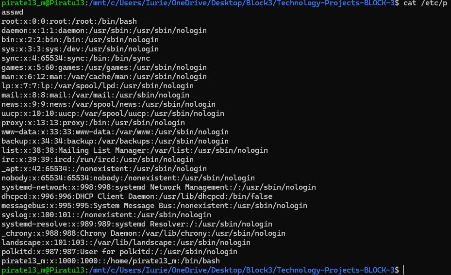
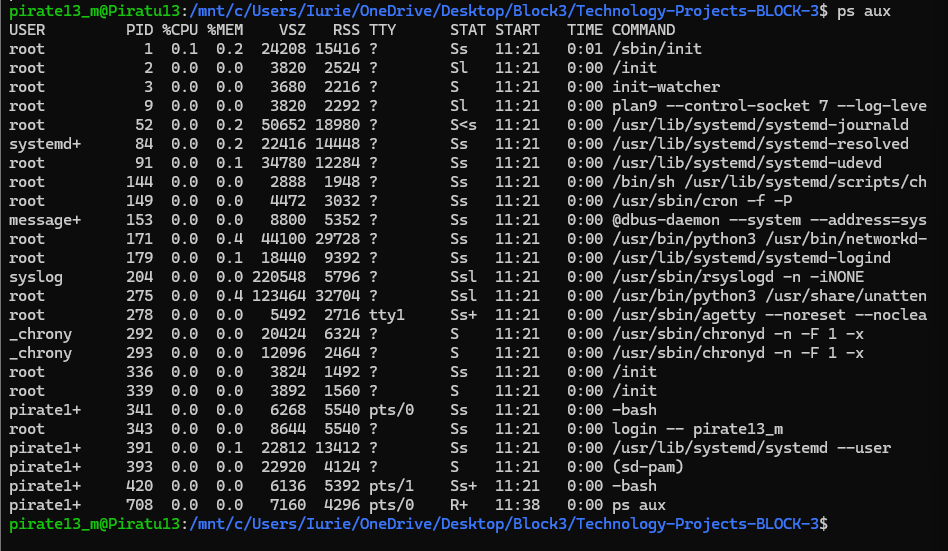
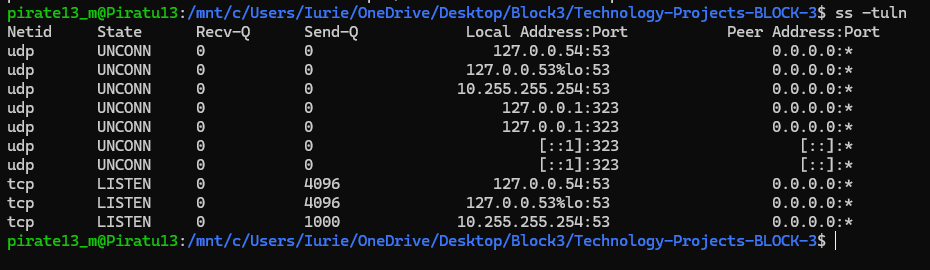

# Exploring Your System's Security

## Task 1 --- List System Users

Run:

    cat /etc/passwd

### Screenshot

### Questions

1.  How many users exist on the system?

The `/etc/passwd` file lists 27 local accounts in my Ubuntu WSL
installation, including my personal account and system accounts.

2.  Which accounts appear to be system accounts?

Accounts such as daemon, sys, www-data, _apt, systemd-network,
messagebus, and syslog appear to be system accounts. Most have
`/usr/sbin/nologin` or `/bin/false` as their shell. The root account
is the administrator account, while pirate13_m is my personal account.

3.  Why do operating systems create system accounts?

Operating systems create system accounts to run services with
their own permissions. This limits which files and resources each
service can access and reduces the damage if a service is compromised.

### Reflection

Explain why understanding system users is important for cybersecurity.

Understanding system users helps me identify personal, administrator,
and service accounts. Checking accounts and their permissions can
help detect unexpected access and services with excessive privileges.
This activity showed me that many Linux accounts exist to support
system functions.

------------------------------------------------------------------------

## Task 2 --- Inspect Running Processes

Run:

    ps aux

### Screenshot

### Questions

1.  Which processes are running as `root`?

My output shows 15 root-owned processes. Examples include /sbin/init,
the WSL /init processes, init-watcher, plan9, systemd-journald,
systemd-udevd, cron, systemd-logind, agetty, and login.
Some command names are shortened in the terminal output.

2.  Why can processes running as root be dangerous?

Root has extensive administrative permissions. If a root-owned
process has a vulnerability or performs an incorrect action, it
could affect protected files, services, and other users.

3.  What could happen if a malicious program ran with root privileges?

It could read or change protected data, create accounts, change
permissions, disable security controls, and disrupt the Linux system.

### Reflection

What did you learn about system processes and security?

I learned that processes run under different user accounts.
The USER column helped me identify processes running as root,
my own account, and service accounts. Running services with only
the permissions they need reduces the damage if they are compromised.

------------------------------------------------------------------------

## Task 3 --- Identify Open Network Ports

Run:

    ss -tuln

### Screenshot

### Questions

1.  Which ports are open?

Port 53 is listening on TCP and has bound UDP sockets.
Port 323 also has bound UDP sockets. UDP shows UNCONN because
it does not establish connections in the same way as TCP.

2.  Which services appear to be listening?

Port 53 suggests DNS services. Port 323 suggests Chrony's
monitoring and control service, which matches the chronyd
processes seen earlier. The command ss -tuln does not display
process names, so these service identifications are inferred.

3.  Why might open ports represent a security risk?

A service listening on a reachable port can receive network traffic.
If it has a vulnerability or insecure configuration, an attacker
may be able to exploit it. The risk depends on the service,
its permissions, and who can reach it.

### Reflection

Explain the relationship between open ports and potential attack
surfaces.

I learned that listening services contribute to a system's attack
surface. The local address helps show where a service accepts traffic.
Most entries used loopback addresses, such as 127.0.0.1 and ::1.
The DNS sockets also included 10.255.255.254, whose accessibility
depends on the WSL network configuration.
