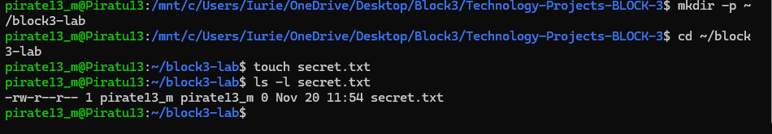
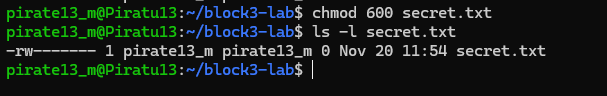
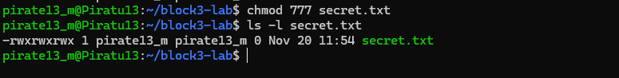

# Understanding File Permissions

## Task 1 --- Create a File

Run:

    touch secret.txt
    ls -l secret.txt

### Screenshot

### Questions

1.  Who owns the file?
The file is owned by pirate13_m. Its group is also pirate13_m.
2.  What are the default permissions?
The permissions shown after creation were rw-r--r-- (644).
The owner can read and write the file. The group and other users
can read it. No execute permission is set.
### Reflection

Why is file ownership important in Linux systems?
File ownership determines which account receives the owner's
permissions. Together, ownership and permissions help control
who can read, modify, or execute a file.

------------------------------------------------------------------------

## Task 2 --- Restrict File Permissions

Run:

    chmod 600 secret.txt
    ls -l secret.txt

### Screenshot

### Questions

1.  Who can read the file now?
The owner, pirate13_m, can read and write the file.
Root can also access it using administrative privileges.

2.  Who cannot access it?
Other ordinary users, including members of the file's group,
have no read, write, or execute permissions on this file.

------------------------------------------------------------------------

## Task 3 --- Open Permissions (Security Risk)

Run:

    chmod 777 secret.txt
    ls -l secret.txt

### Screenshot

### Questions

1.  Who can access the file now?
The owner, group, and other users all have read, write, and execute
permissions on secret.txt. Access also depends on permissions
for the directories containing the file.
2.  Why might this configuration be dangerous?
Other users who can reach the file could read or change its contents.
If the file contained confidential information or executable code,
these permissions could allow information disclosure or tampering.
