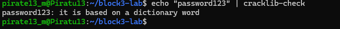
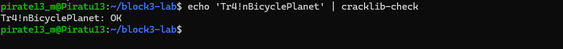

# Password Security

## Task 1 --- Test a Weak Password

Run:

    echo "password123" | cracklib-check

### Screenshot

### Questions

1.  What does the tool say about the password?

CrackLib returned: "it is based on a dictionary word".

2.  Why is this password weak?

It uses the common word "password" followed by the predictable
sequence "123". This makes it easy to guess.

### Reflection

Weak passwords make accounts easier to compromise because attackers
can try common words and predictable patterns. Adding a simple
number sequence to a common word provides little protection.

------------------------------------------------------------------------

## Task 2 --- Test a Strong Password

Run:

    echo "Tr4!nBicyclePlanet" | cracklib-check

### Screenshot

### Questions

1.  What result did the tool return?

CrackLib returned "Tr4!nBicyclePlanet: OK".

2.  What characteristics make this password stronger?

It is 17 characters long and combines several words, uppercase
and lowercase letters, a number, and a symbol. These features
make it less predictable than password123.
### Reflection

Describe at least three characteristics of strong passwords.

Strong passwords should be long, unpredictable, and unique to each
account. A password manager can generate and store random passwords.
Passing CrackLib's checks is useful feedback, although this publicly
shared example should only be used for the exercise.

------------------------------------------------------------------------

## Task 3 --- Password Analysis

Evaluate the following passwords:

-   123456
-   qwerty
-   P@ssword1
-   correcthorsebatterystaple

### Questions

1.  Which passwords are weak?

123456, qwerty, and P@ssword1 are weak because they use common
sequences, keyboard patterns, or predictable substitutions.
The exact phrase correcthorsebatterystaple is also widely known.

2.  Which password is strongest?

For this exercise, correcthorsebatterystaple has the strongest
structure because it is much longer and combines four words.
Its fame makes this exact example unsuitable for a real account.

3.  Why?

Length increases the number of possible combinations. A passphrase
made from randomly selected words can be strong, while common
phrases and predictable patterns are easier to guess.
### Reflection

Explain what you learned about password strength.

I learned that length, unpredictability, and uniqueness matter
when choosing passwords. Replacing letters with familiar symbols
does little to improve a common password. I would use a password
manager to generate a unique password for each account.
