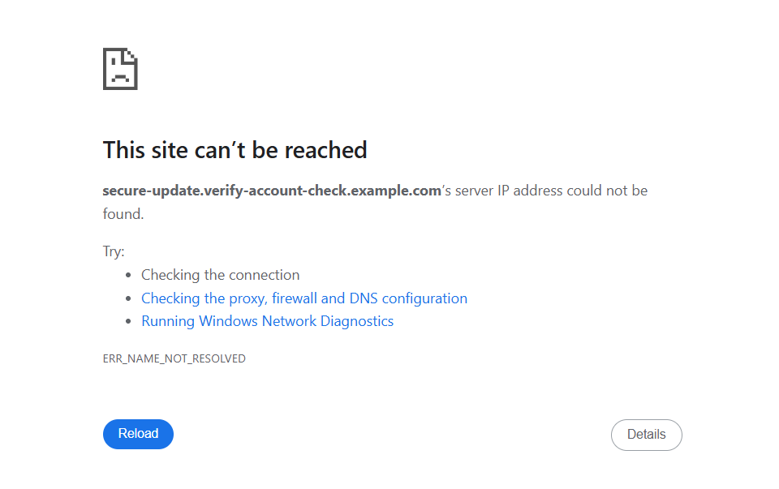

# Phishing Investigation

## Task 1 --- Analyse a Suspicious Email

>**Subject**: ⚠ Urgent: Your Account Will Be Locked in 24 Hours!
>
>**From**: Security Team <support@secure-verification-update.com>
>
>**To**: you@example.com
>
>Hello User,
>
>We detected unusual activity on your account. For your security, your access will be temporarily suspended within 24 hours unless you verify your information.
>
>Please click the link below to avoid interruption:
>
>👉 Verify Your Account Now
[http://secure-update-verification.com/login-confirmation](https://secure-update.verify-account-check.example.com/login/redirect/authentication_step2/?sessionid=3f9a2b8c7d1e44aa92f1b0f8f&token=invalid123456789&continue=http%3A%2F%2Fupdate-alert-confirmation.example.net%2Fverify%2Fuser%2Fsecurity%2Fcheck%2F?id=889201&source=email_warning)
>
>Failure to verify may result in permanent loss of access and data.
If you believe this is a mistake, reply with your full name, date of birth, and password so we can assist you.
>
>**Thank you,**
>
>**Account Support Team**
>
>**Security Department**

### Questions

1.  Who appears to be the sender?
The sender claims to be a security team.
2.  Does the email create urgency or pressure?
The 24-hour deadline creates urgrncy.
3.  Are there spelling or grammar mistakes?
There are no obvious major spelling mistakes, but the greeting is generic.
4.  Does the link match the organisation domain?
The sender, displayed link, and actual destination use different domains.
### Reflection

Explain why attackers use phishing emails.
### Reflection

Attackers use phishing emails to trick people into revealing
passwords or personal information, sending money, or downloading
malicious files. They impersonate trusted organisations and create
fear or urgency to encourage people to act quickly. In this example,
the threat of account suspension pressures the reader to click
the link or share sensitive information.
------------------------------------------------------------------------

## Task 2 --- Link Inspection

Hover over the link in the email (or copy link) and inspect the URL.

### Screenshot

### Questions

1.  Does the displayed link match the actual URL?
No. The displayed address uses secure-update-verification.com,
while the actual destination uses
secure-update.verify-account-check.example.com.
2.  Are there unusual domain names?
Yes. The destination combines security-related words in several
subdomains. Its main domain is example.com. The long URL also
contains a continue parameter pointing to another address under
example.net.
### Reflection

Explain why users should always inspect links before clicking them.
I learned that the text displayed for a link can differ from its
actual destination. Inspecting the destination helps reveal
misleading domains before opening a link or entering information.
A long address containing security-related words does not establish
that a website belongs to a trusted organisation.